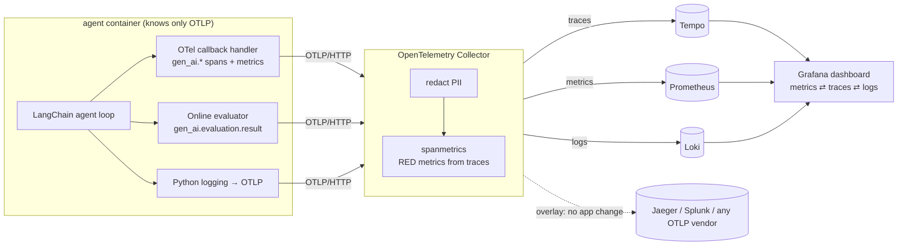

# Agent Observability Demo
**LangChain agent → OpenTelemetry → Collector → Prometheus · Tempo · Loki · Grafana**, plus an online-evaluation layer that catches the failures tracing can't see.

A predictive-maintenance agent (CNC mills, a lathe, sensor readings, service orders) with six failure scenarios you can trigger live. It runs **fully offline** by default (a deterministic tool-calling mock LLM), so meetup Wi-Fi can't break your demo. Flip one env var to use OpenAI or Anthropic.



## Quick start

```bash
cp .env.example .env        # optional; defaults are fine
make up                     # builds the agent, starts 6 containers
make smoke                  # end-to-end check (~40s): scenarios, metrics, traces, logs, redaction
```

**Windows (PowerShell, no `make`):** use `.\demo.ps1 up`, `.\demo.ps1 smoke`, `.\demo.ps1 scenario loop`, `.\demo.ps1 backend-jaeger` and so on. Every Makefile target has the same name there.

| What | Where |
|---|---|
| Control panel (trigger scenarios) | http://localhost:8000 |
| Grafana dashboard | http://localhost:3001/d/agent-observability (no login; change with `GRAFANA_PORT` in `.env`) |
| Prometheus | http://localhost:9090 |
| Jaeger (after `make backend-jaeger`) | http://localhost:16686 |

Background traffic starts automatically (55% healthy, the rest spread across the failure modes), so the dashboard is alive when you open it. Toggle it in the control panel or with `make traffic-off`.

## Deploying online for clients

A production overlay adds HTTPS (Caddy + Let's Encrypt), Grafana logins with read-only Viewer accounts for clients, a password on the control panel, and a token-protected OTLP endpoint, and exposes nothing else. See **[deploy/DEPLOY.md](deploy/DEPLOY.md)**.

```bash
cp deploy/.env.prod.example .env   # fill in domains and secrets
./deploy/deploy.sh
```

## The six scenarios

| Scenario | What breaks | How you see it |
|---|---|---|
| `healthy` | nothing | 4 tool calls, service order opened, all evals pass |
| `tool_error` | sensor gateway returns 503 | red `execute_tool` span with exception event, error log linked to the trace, tool error-rate panel |
| `slow_tool` | manual search takes ~4s | p95 latency per step jumps; click an exemplar to land on the slow span |
| `loop` | tool keeps saying "retry", the agent obeys | `agent.loop_detected` event, iterations panel climbs, loop counter |
| `bad_answer` | agent ignores a critical vibration reading and says "no action needed" | **trace is all green.** Only the evaluation catches it (`grounded_in_evidence`, `required_action_taken` fail) |
| `pii` | user pastes email + phone | Collector redacts them in traces and logs before any backend. The evaluator flags the PII echoed in the answer |

Run one from the terminal: `make scenario S=bad_answer`.

## What's instrumented

**Spans** (OpenTelemetry GenAI semantic conventions):
```
POST /api/run                          (FastAPI native OTel server span, when triggered from the UI)
└─ invoke_agent maintenance-agent      demo.scenario, agent.outcome, agent.iterations, eval.score, eval.passed
   ├─ chat mock-gpt-mini               gen_ai.request.model, gen_ai.usage.input/output_tokens, finish_reasons, messages
   ├─ execute_tool get_asset_info      gen_ai.tool.name, gen_ai.tool.call.id, arguments, result
   ├─ chat ... / execute_tool ...
   └─ evaluate maintenance-agent       one gen_ai.evaluation.result event per check
```

**Metrics**: `agent_runs_total{outcome}`, `agent_run_duration_seconds`, `agent_tool_calls_total{gen_ai_tool_name,status}`, `agent_iterations`, `agent_loop_detected_total`, `agent_evaluations_total{verdict}`, `agent_eval_check_failures_total{check}`, `gen_ai_client_token_usage`, `gen_ai_client_operation_duration_seconds`, plus `traces_span_metrics_*` derived by the Collector from traces alone.

**Logs**: Python `logging` bridged to OTLP. Every record carries `trace_id`/`span_id`, so Grafana links logs ⇄ traces both ways.

The instrumentation is one file, `agent/app/otel_langchain.py`, a LangChain callback handler of about 150 lines. Pass it in `config={"callbacks": [OTelCallbackHandler()]}` on any LangChain runnable. For production you could swap in OpenLLMetry or OpenInference instrumentation; the Collector and backends stay the same.

## Vendor-neutral: change backends at the Collector, never in the agent

The agent's only observability setting is `OTEL_EXPORTER_OTLP_ENDPOINT`. Backends are Collector overlays (extra `--config` files that are deep-merged):

```bash
make backend-jaeger    # Tempo AND Jaeger receive traces; agent container untouched
make backend-vendor    # + an OTLP SaaS (preconfigured for Splunk Observability Cloud; set VENDOR_* in .env)
make backend-default   # back to Tempo only
```

The Collector also does work you don't want in every app: PII redaction (`transform/redact`), RED metrics from spans (`spanmetrics` connector), batching and memory limits.

## Using a real LLM

```bash
# in .env
LLM_PROVIDER=openai        # or anthropic
OPENAI_API_KEY=sk-...      # or ANTHROPIC_API_KEY=...
LLM_MODEL=gpt-4o-mini      # optional; default gpt-4o-mini / claude-haiku-4-5
```
Then run `docker compose up -d agent`. Tool-level faults (`tool_error`, `slow_tool`, `loop`, `pii`) work the same with a real model. `bad_answer` is scripted in the mock: with a real model, the evaluator catches genuinely ungrounded answers when they occur. Set `OTEL_INSTRUMENTATION_GENAI_CAPTURE_MESSAGE_CONTENT=false` to keep prompts and completions out of telemetry entirely.

## Repo layout

```
agent/app/
  telemetry.py         OTel SDK bootstrap + metric instruments
  otel_langchain.py    LangChain callback → gen_ai.* spans and metrics
  agent.py             explicit agent loop, loop guard, outcomes
  evaluator.py         online evaluation checks → span events + metrics
  tools.py             maintenance tools with fault injection
  mock_llm.py          offline tool-calling chat model
  scenarios.py         the six scenarios
  main.py, static/     FastAPI API, control panel, traffic generator
collector/             config.yaml + backend overlays (none | jaeger | vendor)
tempo/ loki/ prometheus/ grafana/   backend configs, datasources (with cross-links), dashboard
scripts/build_dashboard.py           dashboard defined as code → grafana/dashboards/*.json
scripts/smoke_test.py                end-to-end check of the running stack
tests/                               Docker-free telemetry test (fake OTLP receiver)
```

## Testing

- `make test`: no Docker needed. Runs the agent against a fake OTLP receiver and checks 67 things: span tree, GenAI attributes, error statuses, evaluation events, metric names as Prometheus will see them, log ⇄ trace correlation, and the redaction regexes (including no false positives).
- `make smoke`: against the running stack. Checks scenario outcomes, every dashboard metric in Prometheus, the trace in Tempo, that PII is gone from the stored trace, logs in Loki, and the dashboard.

## Troubleshooting

- **Empty panels right after `make up`:** wait ~30s. Rates need two scrapes.
- **"Open trace in Grafana" says not found:** Tempo flushes in ~5s; click again.
- **Collector won't start:** `docker compose logs otel-collector` names the bad key. With `make backend-vendor`, check `VENDOR_TRACES_URL` is set.
- **Port in use:** change the left side of the `ports:` mapping in `docker-compose.yaml`.

Pinned versions: Collector contrib 0.120.0, Tempo 2.7.1, Loki 3.4.2, Prometheus 3.2.1, Grafana 11.5.2, Jaeger 2.5.0.
